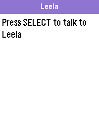

# Leela for Pebble

Press one button, speak, get a reply from Leela (the AI assistant behind our chat server) on your wrist.

Target: Pebble Time 2 (`emery`, 200x228 colour, microphone, speaker). C watch app plus PebbleKit JS (PKJS) on the phone. No Android companion app.



## How it works

1. SELECT starts the built-in Pebble `DictationSession`. Speech-to-text is done by the phone side of the Pebble app; the watch app only receives text.
2. The watch sends the text to PKJS via AppMessage (key `ASK`).
3. PKJS calls the server over HTTPS (`POST /api/pebble/ask`), then polls `GET /api/pebble/ask/{id}?offset=N` until `done`, appending the <=240 byte chunks.
4. PKJS re-splits the finished reply at UTF-8 character boundaries into <=200 byte pieces and pushes them to the watch (`STATE`=chunk, `TEXT`=piece), one AppMessage at a time with acks and retries. The watch reassembles them into a 4 KB buffer.
5. The reply appears in a scrollable plain-text layer. UP/DOWN scroll, SELECT asks a follow-up in the same conversation.

Screens: idle ("Press SELECT to talk to Leela"), listening, thinking (animated dots), reply, error (readable message, SELECT retries).

One `conversation_id` is generated per app launch (PKJS restarts with the app) and reused for follow-ups.

## Build and run

Requires the Pebble SDK (tested: pebble-tool 5.0.40, SDK 4.33.1) and Node/npm.

```
npm install          # pulls pebble-clay (settings page)
pebble build         # produces build/leela-pebble.pbw
pebble install --emulator emery
pebble install --phone <phone-ip>     # real watch, via the Pebble phone app's developer connection
npm test             # unit tests for the PKJS client logic (plain node, mocked XHR)
```

Screenshot of the emulator: `pebble screenshot --emulator emery docs/idle.png`.

## Settings (Clay)

Open the app's settings from the Pebble phone app. All values live in the phone's PKJS `localStorage` only; they are never sent to the watch and never in this repo.

| Setting | Default | Notes |
| --- | --- | --- |
| Server URL | `https://chat.osmosis.page` | |
| Device token | empty | Long-lived bearer token starting `lpd_`. Never logged. |
| Speak replies | off | Placeholder, see TTS below. |

### Creating a device token

Admin dashboard, Leela tab, Pebble devices, Create device. Copy the `lpd_...` token and paste it into the app's settings on the phone.

## Server API used

All requests carry `Authorization: Bearer <device_token>`; errors are `{"detail": "..."}`.

- `POST /api/pebble/ask` body `{"text", "conversation_id"}` (text max 1000 chars) returns `{"id", "state"}`.
- `GET /api/pebble/ask/{id}?offset=N` returns `{"state": pending|done|error, "text" (<=240 bytes), "next_offset", "done"}`. 404 = job expired; an `error` state's text is shown to the user.
- Not used: `/api/pebble/stt` (built-in dictation is used instead) and `/api/pebble/tts` (see below).

Error handling: 401/403 "Token rejected", 429 "Slow down", 404 "reply expired", network failure, 90 s overall timeout.

Rate limit: the server allows 20 req/min per device. PKJS polls once per second (up to ~60/min while a reply is pending), so a long reply can hit 429. On a 429 while polling it waits (`Retry-After` or 5 s) and retries up to 3 times before showing "Slow down". The interval is `POLL_INTERVAL_MS` in `src/pkjs/leela.js`.

## Known limitations

- Emery only (`targetPlatforms`). Other mic-equipped platforms would probably work but are untested.
- Speak replies / TTS is NOT implemented (documented TODO). The Pebble Speaker API (SDK 4.9.169+, `PBL_SPEAKER`, emery and flint) only plays raw mono signed PCM (`SpeakerPcmFormat_8kHz/16kHz_8bit/16bit`). `/api/pebble/tts` returns `audio/mpeg`, and neither the watch nor PKJS can decode MP3. To do it, the server would need to offer raw PCM output (e.g. 16 kHz 16-bit, or u-law like Pebble-Wrist-AI uses), which PKJS would stream to the watch in AppMessage chunks into `speaker_stream_write()`.
- The reply is shown only once complete (no live streaming to the watch).
- The watch fonts cannot draw emoji or non-Latin scripts; curly quotes/dashes/bullets are mapped to ASCII and emoji dropped. Markdown is shown as plain text. Replies are truncated at ~4000 characters.
- If the server splits a chunk in the middle of a multi-byte character the JSON already contains a replacement character; the app cannot repair that.
- No history; the reply is lost when the app is closed.
- The emulator has no voice service, so the full dictation flow has to be tested on a real watch.
